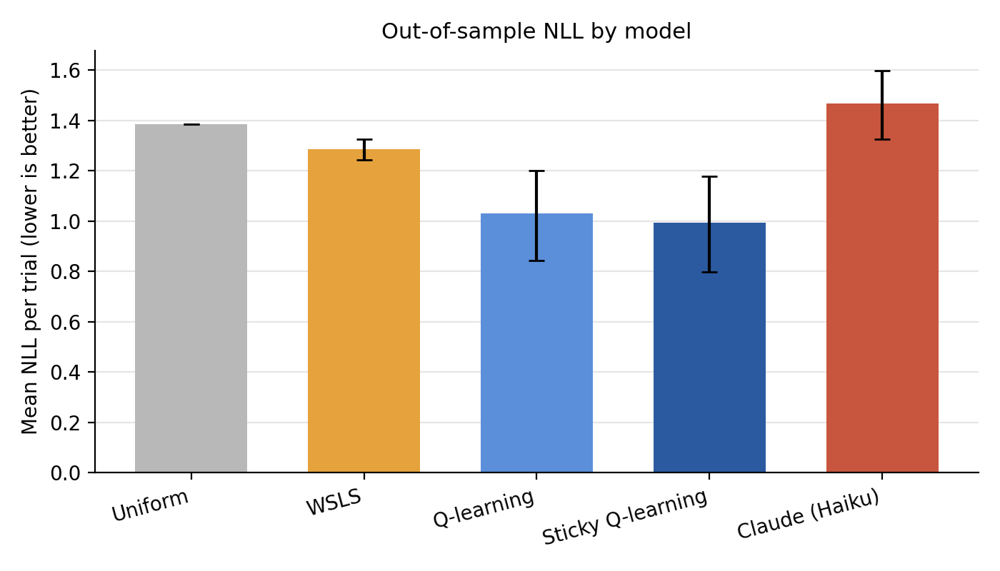
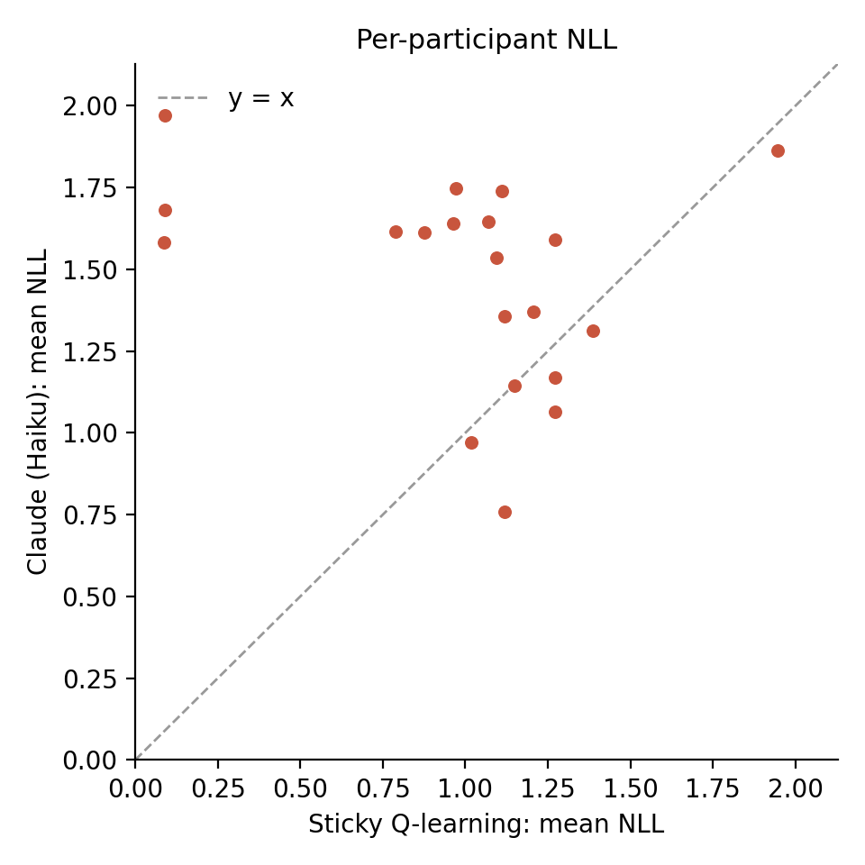
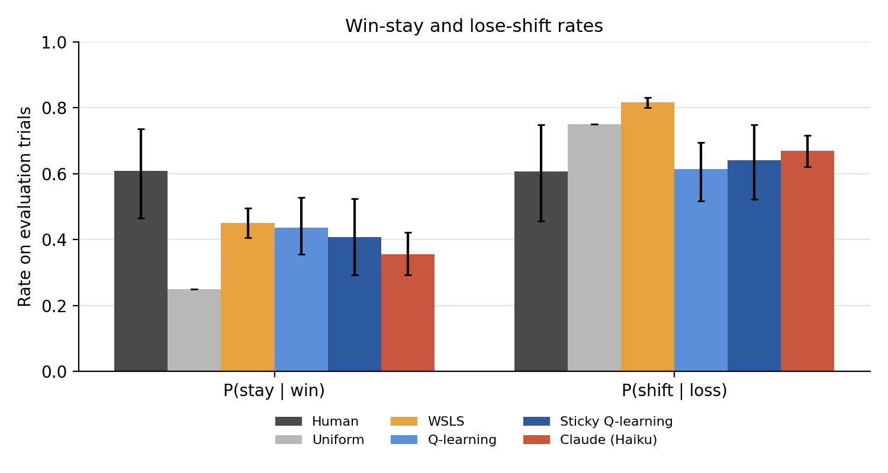

# Can a general-purpose LLM predict human choices in a restless bandit?

This project tests whether an off-the-shelf large language model, prompted zero-shot with a
participant's task instructions and trial-by-trial history, predicts that participant's next
choice better than classic reinforcement-learning models. Following the model-comparison setup
of Binz et al. (2025), "A foundation model to predict and capture human cognition" (*Nature*),
which introduced the Psych-101 dataset and the Centaur model, it compares the LLM with
cognitive models on held-out human choices in a single Psych-101 task. Unlike Centaur, the LLM here is not fine-tuned on Psych-101, and it is scored on probabilities
it states in text rather than on the likelihoods it assigns to choice tokens.

## Summary

Claude Haiku (`claude-haiku-5-5`), used zero-shot and asked to state next-choice probabilities,
was compared with four baselines on the four-armed restless bandit `bahrami2020four` from
Psych-101. The comparison covered 20 participants and 400 held-out evaluation trials. The mean
negative log-likelihood (NLL) of the human choices was 0.995 for sticky Q-learning, 1.032 for
Q-learning, 1.286 for win-stay / lose-shift (WSLS), 1.386 for uniform guessing and 1.468 for
Claude. Both Q-learning models predicted significantly better than Claude (Holm-adjusted Wilcoxon
p = 0.005 for Q-learning and p = 0.015 for sticky Q-learning). Claude's NLL was not
significantly different from uniform guessing (mean difference +0.08, 95% CI −0.06 to 0.21,
p = 0.26). In this setting, zero-shot Claude Haiku did not predict human choices better than
classic cognitive models. The result does not speak to fine-tuned models such as Centaur or to
token-likelihood scoring.

## Data

The data come from [`marcelbinz/Psych-101`](https://huggingface.co/datasets/marcelbinz/Psych-101)
(Apache-2.0). Its public file `prompts_training.jsonl` contains 76 experiments, with one row per
participant (`text`, `experiment`, `participant`). The human's choices are enclosed in `<<…>>`.

The task is `bahrami2020four/exp.csv`, a four-armed restless bandit (original data: Bahrami &
Navajas, 2020, as cited in Psych-101; the paradigm of Daw et al., 2006). On each trial the
participant presses one of four keys and receives between 1 and 98 points. The payoffs of the
arms drift over time. The dataset has 869 participants with up to 150 trials each. The option
letters differ for each participant:

```
You will be asked to repeatedly choose between four different options labeled L, G, O, and U.
You select an option by pressing the corresponding key on your keyboard.
Each time you select an option, you will get a different number of points.
Your goal is to win as many points as possible.

You press <<L>> and get 84.0 points.
You press <<G>> and get 90.0 points.
...
```

I chose this task because it has a single scalar reward per trial and one continuous block with
no hidden context, so standard Q-learning is a well-specified baseline. Every trial line in all
869 transcripts matches a single regular expression. The other bandit tasks in Psych-101
interleave several contexts, reset the arms in short games, or report separate gains and losses.

Twenty participants were drawn with `seed=42` from the 779 participants (of 869) who have at
least 140 trials. The sampled participants have 140–150 trials each.

The letters are randomised, but the position of a label in the instruction sentence corresponds
to a fixed arm. The payoff schedule also appears to be shared across participants: at a given
trial and position, rewards vary by only about 3–8 points between participants. During the
evaluation window, the second-listed arm pays best and receives 52% of choices, while the
first-listed arm receives 19%.

## Method

For each participant, the first half of the trials (`n // 2`, i.e. 70–75 trials) is used to fit
parameters. All models are then evaluated on the same 20 trials: the first 20 trials of the
second half (trials 71–95, depending on the participant). On each evaluation trial, every model
predicts a full probability distribution over the four options, using only the trials before
it.

| Model | Parameters | Description |
|---|---|---|
| Uniform | none | 1/4 for every option |
| WSLS | ε ∈ [0, 1] | Win-stay / lose-shift with lapse ε: `p = (1−ε)·rule + ε/4`. A "win" is a reward ≥ the previous trial's reward; after a loss, the shift probability is split equally among the other three options. |
| Q-learning | α ∈ [0, 1], β ∈ [0, 50] | Delta-rule update of the chosen option's value, softmax choice |
| Sticky Q-learning | α, β, κ ∈ [−5, 5] | Q-learning plus a perseveration bonus κ added to the previous choice's logit |
| Claude (Haiku) | none (zero-shot) | Stated next-choice probabilities, given instructions plus the full history |

The Q-learning models divide rewards by 100 and start every option's value at Q₀ = 0.5, which
is close to the dataset's mean reward of 58.5 points. No fit reached the β or κ bounds, and 5 of
20 participants have α at its upper bound of 1.

The cognitive models are fitted to each participant by maximum likelihood on the first half,
using L-BFGS-B (`scipy.optimize`) from 10 uniform random starts. The fitted model is then run
forward over the whole sequence, so the learned Q-values and the previous choice carry over
into the evaluation trials. `results/fitted_parameters.csv` lists the fitted parameters; its
`fit_nll_sum` column is the summed NLL over the fitting trials.

Each Claude prediction is one non-interactive call to the Claude Code CLI on a subscription
(no API key):

```
claude -p --model haiku --output-format json --max-turns 1 --tools "" \
       --strict-mcp-config --setting-sources "" --no-session-persistence \
       --system-prompt "<short task-neutral system prompt>"
```

The call runs from an empty temporary directory, with no tools, MCP servers, settings or
project files. The CLI reported the model as `claude-haiku-5-5`.

The prompt contains the Psych-101 instructions, then the participant's actual trials 1…t−1
from both halves, rendered exactly as in Psych-101. It ends with a request for only a JSON
object that maps each option label to a probability. The full prompt is in
[`src/claude_predictor.py`](src/claude_predictor.py).

The JSON keys must be exactly the four option labels. Values between 0 and 1 are renormalised
to sum to 1. Values that sum to between 95 and 105 are read as percentages and divided by 100.
Any other values, such as negative numbers, are rejected. A rejected response is retried once,
and if the retry also fails, that trial gets a uniform prediction and is logged as a parse
failure.

All responses are cached under `.cache/claude/`, keyed by SHA-256 of model, system prompt and
prompt. Successful responses and malformed outputs are cached. CLI or transport errors, such
as timeouts, are not cached, so they are retried on the next run. The prompt was fixed before
any outcome-based evaluation, and the 2-participant pilot was used only to check cost and
parsing.

All metrics are computed on the 400 evaluation trials (20 participants × 20 trials):

- The primary metric is the mean NLL of the human's choice, with probabilities clipped to
  [1e-6, 1]; chance is ln 4 = 1.386.
- Accuracy is the expected argmax accuracy under random tie-breaking. If the choice is one of
  m options tied for the highest probability, the trial scores 1/m, so a uniform prediction
  scores exactly 0.25.
- The Brier score is the multi-class Brier score.

For each metric, I compute the paired per-participant difference between Claude and each other
model. Each difference gets a 95% bootstrap confidence interval (10,000 resamples of
participants) and a two-sided Wilcoxon signed-rank test, with p-values Holm-adjusted across the
four comparisons within each metric. Win counts give the number of participants for whom each
model has the lowest NLL.

## Results

Mean across participants, with 95% bootstrap confidence intervals for NLL:

| Model | Mean NLL ↓ | 95% CI | Accuracy ↑ | Brier ↓ |
|---|---|---|---|---|
| Uniform | 1.386 | [1.386, 1.386] | 0.250 | 0.750 |
| WSLS | 1.286 | [1.243, 1.327] | 0.416 | 0.684 |
| Q-learning | 1.032 | [0.844, 1.200] | **0.629** | 0.556 |
| Sticky Q-learning | **0.995** | [0.798, 1.179] | 0.616 | **0.530** |
| Claude (Haiku) | 1.468 | [1.326, 1.599] | 0.331 | 0.847 |

Claude's mean NLL and Brier score are worse than uniform's, but the paired tests do not show a
reliable difference: the NLL difference is +0.08 (95% CI −0.06 to 0.21, p = 0.26), and Claude
has the lower NLL for 8 of 20 participants. Its accuracy is slightly above chance (0.33 vs 0.25,
p = 0.16, not significant). Together, these results suggest that Claude's stated probabilities
sometimes point to the right option but are poorly calibrated.

Paired differences in mean NLL (Claude minus the other model; positive means Claude is worse):

| Compared with | Mean Δ NLL | 95% bootstrap CI | Wilcoxon p | p (Holm) | Claude better in |
|---|---|---|---|---|---|
| Uniform | +0.082 | [−0.060, 0.212] | 0.261 | 0.261 | 8 / 20 |
| WSLS | +0.183 | [0.030, 0.328] | 0.040 | 0.080 | 6 / 20 |
| Q-learning | +0.437 | [0.203, 0.692] | 0.001 | 0.005 | 5 / 20 |
| Sticky Q-learning | +0.474 | [0.214, 0.747] | 0.005 | 0.015 | 7 / 20 |

Brier score and accuracy show the same pattern. On both, Claude is significantly worse than
both Q-learning models and not significantly different from uniform. The one exception is that
Claude's Brier score is significantly worse than WSLS's (p_Holm = 0.04). The full table is in
`results/paired_stats.csv`.

By lowest mean NLL, the best model per participant was sticky Q-learning for 12 participants,
Claude for 5, WSLS for 2, Q-learning for 1 and uniform for none.



*Figure 1. Mean negative log-likelihood per trial of the human's choice on the 400 evaluation
trials (lower is better). Error bars are 95% bootstrap confidence intervals over participants.
Uniform equals chance (ln 4 = 1.386).*



*Figure 2. Mean NLL per participant for sticky Q-learning (the best cognitive baseline) against
Claude. Points below the diagonal are participants for whom Claude predicts better; this holds
for 7 of 20 participants.*

On the evaluation trials, humans stayed after a win 61% of the time and shifted after a loss
61% of the time; overall they repeated their previous choice on 50% of trials. Claude's
predictions imply a win-stay rate of only 36% (95% CI 29–42%) and a lose-shift rate of 67%. In
other words, Claude underestimates how often people repeat a choice: its predictions are more
exploratory and switch-prone than the humans' behaviour, not more "rational". The fitted RL
models also underestimate win-stay (41–44%), but by less, and they match lose-shift closely
(61–64%).



*Figure 3. Human win-stay and lose-shift rates on the evaluation trials, compared with the
rates implied by each model's predicted probability of repeating the previous choice. A trial
counts as a win if its reward is at least the previous trial's reward. Error bars are 95%
bootstrap confidence intervals over participants.*

Across all 400 evaluation trials, Claude assigned less than 0.1 to the human's actual choice on
14% of trials, against 4.8% for sticky Q-learning. Under the log score, these confident misses
are what push its mean NLL above chance.

For example, the three participants that sticky Q-learning predicts best (413, 434 and 492, each with NLL ≈ 0.09) each exploited one
arm for about 55 trials. After that arm's payoff declined, each switched to a second arm and
chose it on all 20 evaluation trials. For all three, Claude put 0.7–0.8 on the arm they had just
left, which had the highest long-run average reward (NLL 1.6–2.0). This suggests Claude may
weight cumulative history over recent outcomes, which is a poor fit for a restless bandit where
recency-weighted learning is needed. This hypothesis comes from three hand-picked cases. Testing
it would require, for example, regressing Claude's predictions on recency-weighted and
cumulative reward averages across all trials.

The 400 predictions took 406 CLI calls, at a mean of 1.8 seconds per call. Six responses added
an extra key (for example `"_note"`) and were retried; five of those retries succeeded, and one
prediction fell back to uniform. Input totalled about 0.96M tokens and output about 22k tokens
(`results/claude_run_report.json`).

## Limitations

- This is not a test of Centaur's approach, and it differs from Binz et al. (2025) in the two
  respects most likely to matter.
  - Centaur is Llama 3.1 70B fine-tuned on Psych-101 transcripts, including this task. Here, a
    general-purpose LLM is used zero-shot, in context, and sees no choice data from this task
    beyond the current participant's own history.
  - Centaur's predictions are scored with the probability the language model assigns to the
    choice token after `<<`, a distribution trained by gradient descent to match human choice
    frequencies. Here, Claude states probabilities in JSON, because the CLI does not expose
    token log-probabilities. Stated probabilities are coarse (often rounded to 0.05, 0.2 or 0.7)
    and are not trained to be calibrated against human behaviour. Poor calibration, rather than
    a poor grasp of the task, may explain much of the NLL gap, and the above-chance accuracy is
    consistent with that.
  - The study therefore shows that one convenient zero-shot usage pattern does not work well
    for this task. It does not show that LLM-based models of cognition cannot work.
- The scope is narrow. The study covers a single restless-bandit task, whereas Binz et al.
  evaluate across many experiments, so its conclusions may not transfer to other paradigms. Its
  payoff schedule appears to be shared across participants, so the evaluation window covers the
  same phase of the task for everyone, and results might differ in other phases. With 20
  participants and 20 evaluation trials each (400 predictions), the confidence intervals are
  wide. Non-significant differences, such as Claude vs uniform, should not be read as evidence
  of equivalence.
- Only one LLM, the smallest tier, was tested with one prompt. Larger Claude models, other
  wordings, chain-of-thought, or few-shot examples from other participants might perform
  differently. The prompt was not tuned on the outcomes.
- The cognitive baselines are standard but simple.
  - With continuous payoffs, defining a win as a reward ≥ the previous reward is a noisy proxy
    for a good outcome, and it makes WSLS a weak baseline. The fitted lapse rate is high (mean
    ε = 0.73), and 2 of 20 participants reached ε = 1, at which point WSLS is identical to
    uniform.
  - A Kalman-filter learner with an exploration bonus (as in Daw et al., 2006) would probably be
    stronger than the Q-learning models.
  - The cognitive models are fitted on 70–75 trials per participant, whereas the LLM sees the
    same trials only in context.
- Psych-101 and the original data are public, so parts may appear in the LLM's pretraining
  data. Given the result, such contamination evidently did not help here.
- Evaluation trials are consecutive and serially dependent, which is why inference is done at
  the participant level.

## Reproduction

```bash
python -m venv .venv && source .venv/bin/activate
pip install -r requirements.txt
pytest                  # parser, model, metric and prompt/parsing/caching tests (offline)
python run_all.py       # data → fits → Claude predictions → results/ and figures/
```

On the first run, `run_all.py` streams Psych-101 once and saves only the `bahrami2020four` rows
to `data/`. It needs a logged-in [Claude Code CLI](https://docs.claude.com/en/docs/claude-code)
and removes `ANTHROPIC_API_KEY` from the subprocess environment, so the CLI uses the
subscription login. Cached responses in `.cache/claude/` are reused, so a rerun makes no new
calls. The cache is not distributed with this repository, so a fresh clone makes about 400 new
calls. Because LLM sampling is stochastic, a fresh clone will produce slightly different Claude
numbers. `python run_all.py --pilot` runs only the first two participants and reports call
statistics.

The pipeline writes per-trial predictions, summary tables and statistical tests to `results/`
and regenerates the three figures in `figures/`.

## References

- Binz, M., et al. (2025). A foundation model to predict and capture human cognition. *Nature*.
- Bahrami, B., & Navajas, J. (2020). Four-armed restless bandit data, `bahrami2020four` in
  Psych-101 (as cited in Binz et al., 2025).
- Daw, N. D., O'Doherty, J. P., Dayan, P., Seymour, B., & Dolan, R. J. (2006). Cortical
  substrates for exploratory decisions in humans. *Nature*, 441, 876–879.

## License

The code is released under the MIT license (see `LICENSE`). The three transcripts in
`tests/fixtures/` are from Psych-101 (Apache-2.0).

## Author

Mehdi Shakibayi, MSc Data Science for Economics and Health, Università degli Studi di Milano
